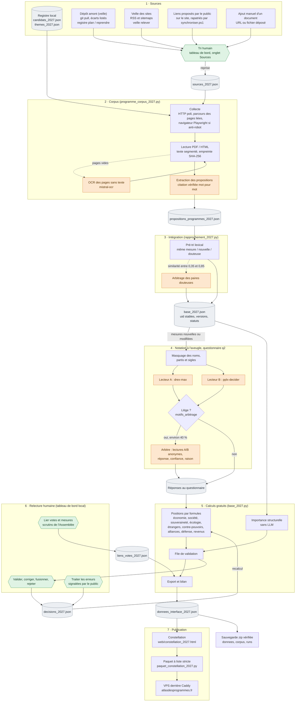

# Boussole civique — présidentielle 2027

Lire les programmes des candidats à l'élection présidentielle de 2027, en extraire des propositions **sourcées** (chaque proposition renvoie à une citation retrouvée mot pour mot dans le document), les faire lire **à l'aveugle** par des modèles de langue, calculer leurs positions par des **formules publiques**, et montrer le tout dans une carte interactive : la *constellation*.

Site public : **[atlasdesprogrammes.fr](https://atlasdesprogrammes.fr)**.

> Outil indépendant. Les données sont produites en grande partie par des modèles et ne sont pas toutes relues par un humain (badge « non relue » dans la constellation). Le corpus est incomplet. Les positions décrivent ce que disent les textes, pas les intentions des candidats. Détail : pages *Avertissement*, *Méthode* et *Coulisses* de la constellation.

Le code, la documentation et les identifiants de données sont en français.

---

## Sommaire

- [Principes](#principes)
- [Le workflow](#le-workflow)
- [Installation](#installation)
- [Démarrage rapide](#démarrage-rapide)
- [Commandes principales](#commandes-principales)
- [Organisation du dépôt](#organisation-du-dépôt)
- [Données](#données)
- [Mise en ligne](#mise-en-ligne)
- [Documentation](#documentation)

## Principes

| Principe | En pratique |
|---|---|
| **Sourcé** | Une proposition n'est acceptée que si sa citation est retrouvée textuellement dans les segments collectés. L'OCR ne garde que le texte du parseur, jamais une transcription générée par un modèle. |
| **À l'aveugle** | Les noms des candidats, partis, sigles et proches sont masqués avant toute lecture par un modèle (`commun_2027.masquer_alias`). Les modèles répondent à un questionnaire factuel ; ils ne donnent pas de note de position. |
| **Formules publiques** | Les positions sur chaque axe sont calculées à partir des réponses par des règles explicites ([questionnaire_q2_2027.py](questionnaire_q2_2027.py), [docs/questionnaire_q2_2027.md](docs/questionnaire_q2_2027.md)). L'importance d'une mesure est structurelle (redites, mesures proches, précision, place dans le document), sans modèle. |
| **Humain en dernier mot** | Rien n'entre dans le corpus sans validation ; les décisions humaines (`donnees/decisions_2027.json`) ne sont jamais écrasées par un run ; un signalement du public ne modifie jamais la base par lui-même. |
| **Aucun appel payant par défaut** | Sans `--max-cost` (ou `--max-calls` pour le corpus), toute commande reste en plan. Plafond par run et plafond mensuel ; les caches évitent de repayer une lecture. |
| **Inconnu ≠ zéro** | Une valeur inconnue reste `null`. Un coût annuel n'est chiffré qu'à partir d'un montant explicitement annuel. |
| **Votes à part** | Les votes à l'Assemblée sont affichés dans les fiches, mais n'entrent ni dans la notation, ni dans l'importance, ni dans les positions. |

## Le workflow

Légende : rectangles pleins = étapes gratuites et locales ; **orange** = étapes payantes (appels LLM via OpenRouter, toujours plafonnées) ; **vert** = validation humaine ; **gris** = fichiers.



### Ce qui se passe à chaque étape

1. **Sources.** Le registre local ([registre_2027.py](registre_2027.py)) liste les candidats, leurs liens de programme et les thèmes. Le dépôt amont (`upstream_repo/`, projet tiers) n'est plus qu'une veille : ses écarts avec le registre sont listés, jamais appliqués automatiquement. La veille des sites ([veille_2027.py](veille_2027.py)) relève les flux RSS et sitemaps des candidats (robots.txt respecté, une requête par seconde et par hôte). Tout ce qui arrive (veille, public, ajout manuel) passe par un tri humain dans le tableau de bord.
2. **Corpus.** [programme_corpus_2027.py](programme_corpus_2027.py) collecte les documents, lit PDF et HTML en segments, fait l'OCR des pages sans texte (payant, plafonné), puis extrait des propositions atomiques par LLM. Chaque citation doit être retrouvée dans le texte collecté. Cache par empreinte : relancer ne repaie rien ; un document modifié invalide son extraction.
3. **Intégration.** [rapprochement_2027.py](rapprochement_2027.py) compare les propositions nouvelles aux mesures existantes du même candidat : même mesure (source ajoutée), nouvelle mesure, ou paire douteuse arbitrée par un modèle. La base ([base_2027.py](base_2027.py)) garde des identifiants stables `m-<candidat>-<n>`, les versions et les statuts.
4. **Notation.** Questionnaire q2 ([questionnaire_q2_2027.py](questionnaire_q2_2027.py), [lecture_q2_2027.py](lecture_q2_2027.py), [arbitrage_q2_2027.py](arbitrage_q2_2027.py)) : deux modèles de décision lisent chaque mesure masquée ; en cas de litige, un troisième modèle arbitre entre les deux lectures présentées anonymement, avec confiance et raison.
5. **Calculs.** Gratuits et reproductibles : positions sur chaque axe, importance, file de validation, export pour la constellation et bilan du run dans `runs/`.
6. **Relecture humaine.** Le tableau de bord local ([tableau_de_bord_2027.py](tableau_de_bord_2027.py), 127.0.0.1:8765) sert à valider ou corriger les mesures, traiter les signalements du public et lier à la main des scrutins de l'Assemblée aux mesures ([votes_2027.py](votes_2027.py)).
7. **Publication.** La constellation lit l'export. Elle est servie en local par [serveur_constellation_2027.py](serveur_constellation_2027.py) ou publiée sur un VPS par un paquet à liste stricte. Les contributions du public reviennent sur le PC par `synchroniser.ps1`.

La commande `mise-a-jour --complet` enchaîne les étapes 1 à 5 sous un plafond de dépense unique, puis lance la sauvegarde ([chaine_2027.py](chaine_2027.py)).

## Installation

Python 3.10 ou plus récent. Une seule dépendance obligatoire :

```powershell
python -m pip install -r requirements.txt
```

Dépendances optionnelles :

| Usage | Paquets |
|---|---|
| Collecte des sites à contrôle anti-robot (hôtes listés dans `navigateur` de `donnees/sources_surcharges.json`) | `playwright` |
| Recherche « Par le sens » du tableau de bord | `numpy` (API) ; `onnxruntime tokenizers` (modèle local de secours) |

Configuration : copier `.env.example` en `.env` et renseigner `OPENROUTER_API_KEY`, `OPENROUTER_SCORING_MODEL`, `OPENROUTER_WEB_MODEL` (valeurs littérales, pas de commentaire en fin de ligne). La recherche sémantique a sa propre clé et son propre plafond dans `.env.recherche` (modèle : `.env.recherche.example`). Ces fichiers sont ignorés par git.

## Démarrage rapide

```powershell
# 1. Vérifier que tout fonctionne (aucun appel réseau ni payant : API simulées)
python -m unittest discover -s tests

# 2. Voir l'état de la base, de la file et des batchs (gratuit)
python .\boussole_2027.py plan

# 3. Recalculer positions, file, export et bilan (gratuit)
python .\boussole_2027.py mise-a-jour

# 4. Ouvrir la constellation sur http://localhost:8000/
python .\serveur_constellation_2027.py
```

> Ne jamais servir le dossier avec `python -m http.server` : il publierait `.env`, les journaux et la base. Le serveur de la constellation ne publie que la page et l'export.

## Commandes principales

Tout passe par [boussole_2027.py](boussole_2027.py). Le guide complet des options est [docs/guide_pipeline_2027.md](docs/guide_pipeline_2027.md).

```powershell
# Chaîne complète
python .\boussole_2027.py mise-a-jour --complet                              # collecte gratuite, puis plan : aucun appel payant
python .\boussole_2027.py mise-a-jour --complet --max-cost 1 --mensuel 5     # chaîne complète plafonnée (1 $ ce run, 5 $ par mois)

# Notation
python .\boussole_2027.py annoter --q2                                       # plan : mesures à lire, coût estimé
python .\boussole_2027.py annoter --q2 --max-cost 2                          # lecture plafonnée
python .\boussole_2027.py annoter --q2 --batch-submit --max-cost 5           # arbitre en batch (non annulable)
python .\boussole_2027.py annoter --q2 --batch-collect                       # récupération et application

# Relecture humaine
python .\boussole_2027.py tableau-de-bord                                    # http://127.0.0.1:8765
python .\boussole_2027.py decision --uid m-xxx-0001 --type validation

# Sources et veille (gratuit)
python .\boussole_2027.py registre plan --pull                               # écarts entre l'amont et le registre
python .\boussole_2027.py veille relever                                     # flux RSS et sitemaps -> file de tri

# Votes à l'Assemblée
python .\boussole_2027.py votes plan

# Sauvegarde des données non versionnées
python .\boussole_2027.py sauvegarder [--essai | --lister | --verifier ARCHIVE]
```

Codes de sortie de la chaîne : `0` terminé, `1` arrêt de sécurité (trop de propositions nouvelles d'un coup, `--forcer` après vérification), `2` erreur (dont les erreurs HTTP permanentes, cache conservé), `3` plafond atteint, `4` sauvegarde échouée.

## Organisation du dépôt

```text
boussole_2027.py          point d'entrée unique
*_2027.py                 modules actifs (base, chaîne, corpus, questionnaires, lecture, rapprochement, veille, votes…)
web/                      constellation et tableau de bord (HTML autonomes)
tests/                    tests unitaires, sans réseau
docs/                     guide d'exécution, spécifications, notes de méthode, journal (docs/suivi/)
donnees/                  entrées versionnées et sorties générées (voir ci-dessous)
deploiement/              scripts de mise en ligne (VPS, Caddy, service systemd)
archives/                 ancienne chaîne et anciens résultats, hors pipeline courant
```

Modules par rôle :

| Rôle | Modules |
|---|---|
| Orchestration | [boussole_2027.py](boussole_2027.py), [chaine_2027.py](chaine_2027.py) |
| Sources | [registre_2027.py](registre_2027.py), [veille_2027.py](veille_2027.py), [update_corpus_2027.py](update_corpus_2027.py) |
| Corpus | [programme_corpus_2027.py](programme_corpus_2027.py) |
| Base et calculs | [base_2027.py](base_2027.py), [rapprochement_2027.py](rapprochement_2027.py) |
| Notation | [questionnaire_q2_2027.py](questionnaire_q2_2027.py), [lecture_q2_2027.py](lecture_q2_2027.py), [arbitrage_q2_2027.py](arbitrage_q2_2027.py), [commun_2027.py](commun_2027.py) ; q1 historique : [questionnaire_2027.py](questionnaire_2027.py), [annotation_2027.py](annotation_2027.py), [contexte_2027.py](contexte_2027.py) |
| Essais et évaluation | [essai_q2_2027.py](essai_q2_2027.py), [relecture_q2_2027.py](relecture_q2_2027.py), [comparer_modeles_2027.py](comparer_modeles_2027.py), [decisions_2027.py](decisions_2027.py), [essai_embeddings_2027.py](essai_embeddings_2027.py) |
| Interfaces | [tableau_de_bord_2027.py](tableau_de_bord_2027.py), [serveur_constellation_2027.py](serveur_constellation_2027.py), [contributions_2027.py](contributions_2027.py), [recherche_semantique_2027.py](recherche_semantique_2027.py) |
| Votes | [votes_2027.py](votes_2027.py) |
| Exploitation | [sauvegarde_2027.py](sauvegarde_2027.py), [paquet_constellation_2027.py](paquet_constellation_2027.py), [llm_logging_2027.py](llm_logging_2027.py) |

## Données

Tous les chemins viennent de `boussole_2027.chemins()`, relatifs à `--racine` (le dossier courant par défaut).

**Versionnées** (saisies à la main) : `donnees/candidats_2027.json`, `themes_2027.json`, `sources_2027.json`, `sources_surcharges.json`, `decisions_2027.json`, `votants_2027.json`, `liens_votes_2027.json`, `etalons_q2_2027.json`, `gel_q2_v5_2027.json` (textes figés, à ne pas modifier).

**Ignorées par git** (générées, volumineuses ou propres au PC) : la base `base_2027.json`, l'export `donnees_interface_2027.json`, les caches des lectures payées (`cache_*.json`), les états de batch, le budget, les contributions et signalements du public, ainsi que les dossiers `corpus_programmes/`, `logs/`, `runs/`, `sauvegardes/`. Ces données n'ont pas d'autre copie que les archives de `sauvegarder` : les caches et le corpus représentent des lectures déjà payées.

Le journal complet des appels aux modèles (requêtes, réponses, coûts, clés masquées) est écrit en JSONL dans `logs/` ([llm_logging_2027.py](llm_logging_2027.py)).

## Mise en ligne

Le pipeline, la base, les caches, `.env` et le tableau de bord restent sur le PC. Seuls la page, l'export et le petit serveur de contributions partent sur le VPS :

```powershell
python .\paquet_constellation_2027.py --essai                          # contenu du paquet, rien n'est écrit
.\deploiement\publier.ps1 -Hote utilisateur@serveur [-Domaine exemple.fr]
.\deploiement\synchroniser.ps1 -Hote utilisateur@serveur               # rapatrie contributions et signalements
```

Le paquet est refusé s'il contient un chemin local ou une clé, ou si les mentions légales ne sont pas complètes. Détail : [docs/mise_en_ligne_2027.md](docs/mise_en_ligne_2027.md).

## Documentation

| Document | Contenu |
|---|---|
| [docs/guide_pipeline_2027.md](docs/guide_pipeline_2027.md) | Guide d'exécution, source de vérité pour les options |
| [SUIVI_PROJET.md](SUIVI_PROJET.md) | État courant, décisions durables, reste à faire ; journal daté dans [docs/suivi/](docs/suivi/) |
| [docs/questionnaire_q2_2027.md](docs/questionnaire_q2_2027.md) | Questionnaire q2 et règles de calcul |
| [docs/spec_pipeline_unifie_2027.md](docs/spec_pipeline_unifie_2027.md) | Spécification du pipeline unifié |
| [docs/spec_veille_2027.md](docs/spec_veille_2027.md) | Veille documentaire indépendante |
| [docs/spec_votes_2027.md](docs/spec_votes_2027.md) | Votes parlementaires |
| [docs/review_notation_2027.md](docs/review_notation_2027.md) | Revue de la notation et comparaison de modèles |
| [docs/mise_en_ligne_2027.md](docs/mise_en_ligne_2027.md) | Mise en ligne sur un VPS |
| [CLAUDE.md](CLAUDE.md) | Repères pour un assistant de code : architecture, pièges |

## Remerciements

La liste initiale des candidats et de leurs liens de programme vient du projet [presidentielle-2027-comparateur](https://github.com/coucou123212321232123/presidentielle-2027-comparateur), désormais suivi comme une source de veille parmi d'autres.
